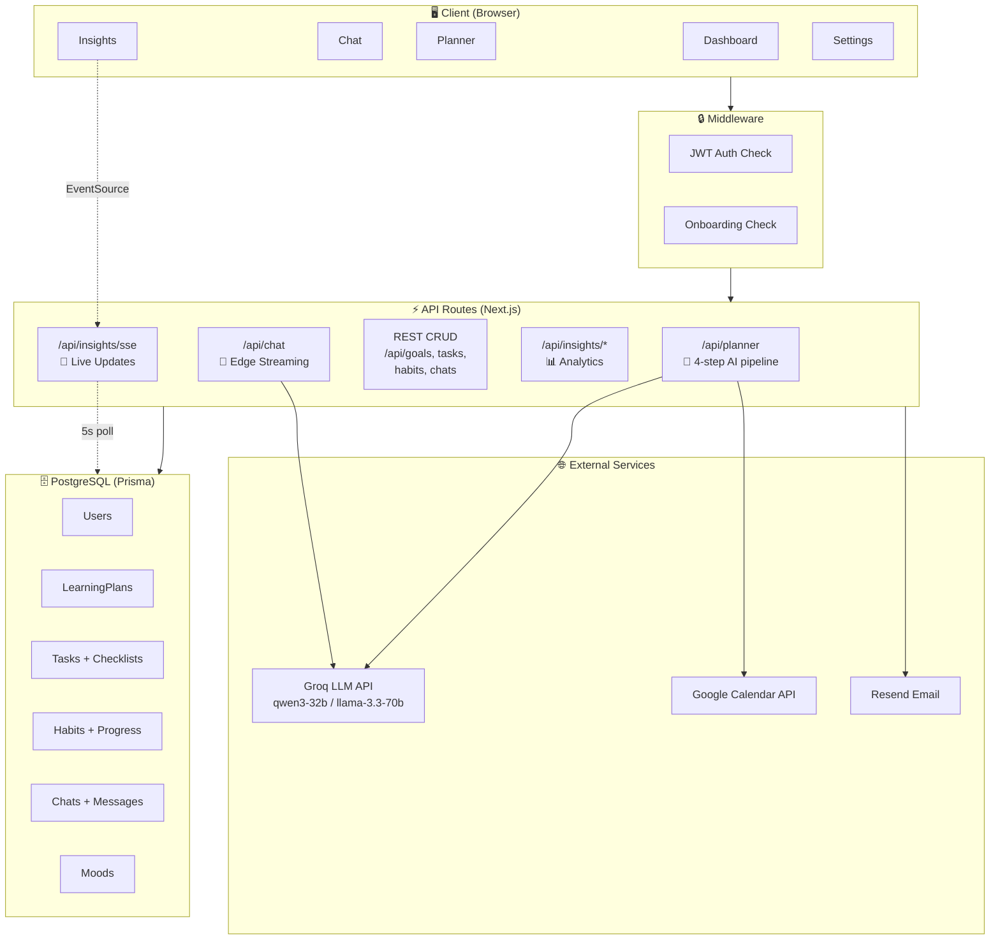
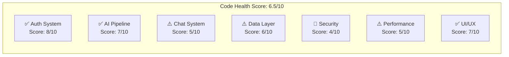
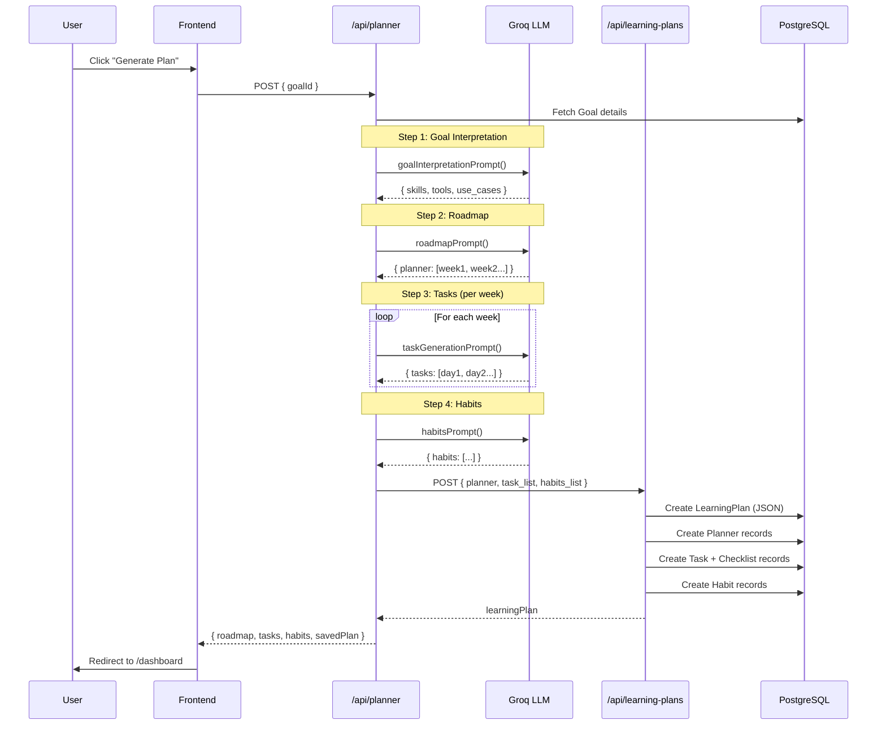
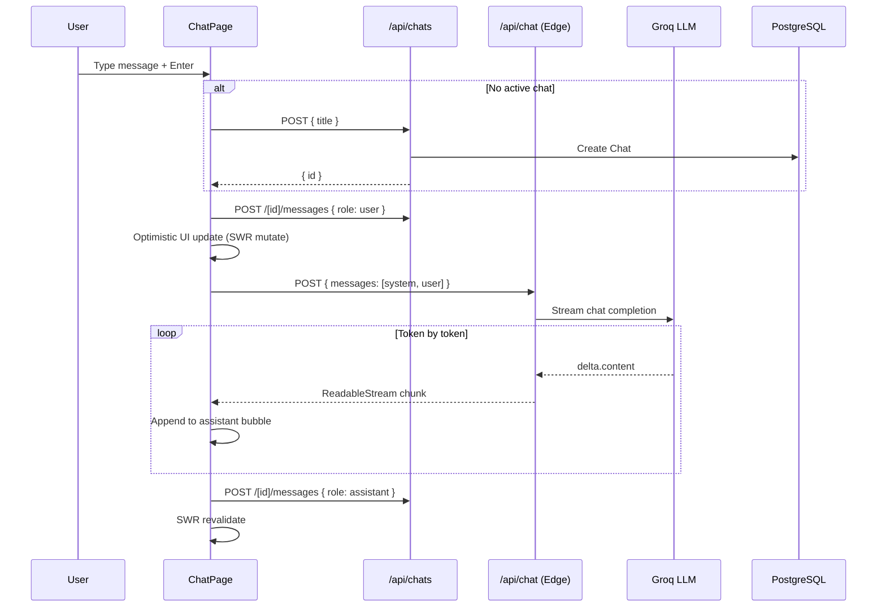
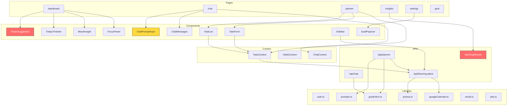
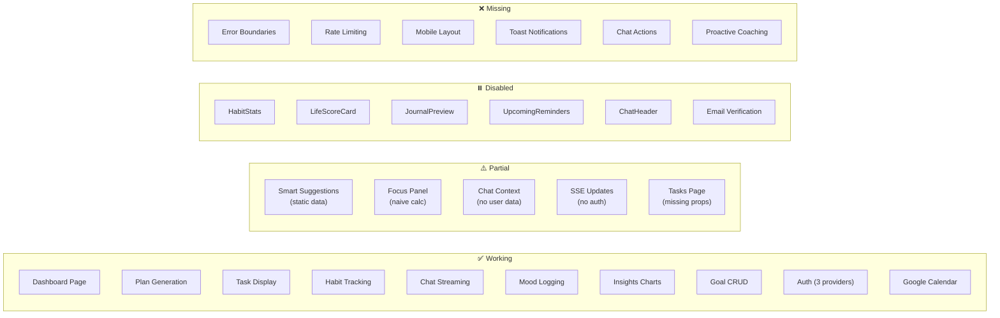
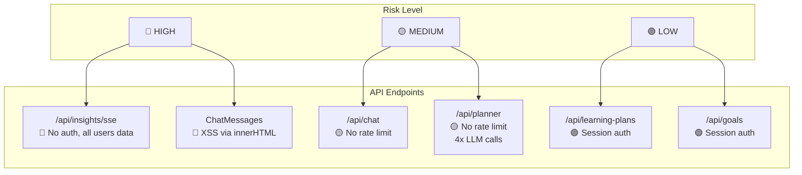
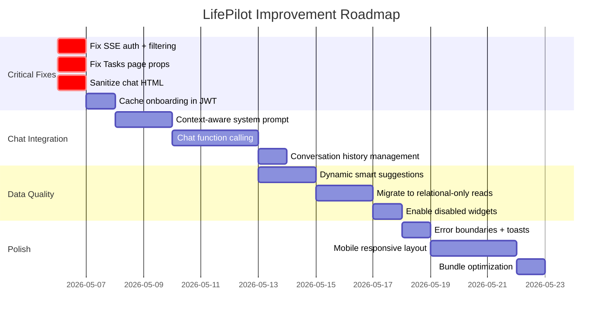

# LifePilot — Code Review Graphs

---

## 🏗️ System Architecture

---

## 📊 Health Scorecard

### Detailed Scores

| Category | Score | Key Issues |
|----------|-------|------------|
| **Authentication** | 8/10 | ✅ 3 providers, JWT refresh, onboarding guard. ⚠️ Middleware performance |
| **AI Pipeline** | 7/10 | ✅ 4-step generation, retry logic, JSON extraction. ⚠️ Date parsing bugs (fixed) |
| **Chat System** | 5/10 | ✅ Streaming works, history persisted. 🔴 No context awareness, no actions, XSS risk |
| **Data Layer** | 6/10 | ✅ Prisma + relations work. ⚠️ Dual storage pattern, missing indexes, SSE queries all users |
| **Security** | 4/10 | 🔴 SSE no auth, XSS in chat, no rate limiting, email verification disabled |
| **Performance** | 5/10 | ⚠️ Middleware DB call per request, SSE 5s polling, no query optimization |
| **UI/UX** | 7/10 | ✅ Clean dark theme, glassmorphism, Recharts. ⚠️ Static suggestions, disabled widgets |

---

## 🔄 Request Flow — Plan Generation

---

## 🔄 Request Flow — Chat Message

---

## 📦 Module Dependency Graph

> 🔴 Red = Critical issues &nbsp;&nbsp; 🟡 Yellow = Needs improvement

---

## 🧱 Component Status Matrix

---

## 🔐 Security Heat Map

---

## 📈 Database Query Frequency

| Endpoint | Frequency | Records Touched | Risk |
|----------|-----------|----------------|------|
| `/api/insights/sse` | Every 5s per client | ALL tasks + ALL habits + completions | 🔴 **Critical** |
| `/api/user/profile` | Every page navigation (middleware) | 1 user | 🟡 Medium |
| `/api/planner` | Per plan generation | 4-8 Groq calls + cascading inserts | 🟡 Medium |
| `/api/tasks/today` | On dashboard load | Filtered by userId + date | 🟢 Low |
| `/api/mood` | On dashboard load | Filtered by userId | 🟢 Low |

---

## 🗺️ Improvement Roadmap

