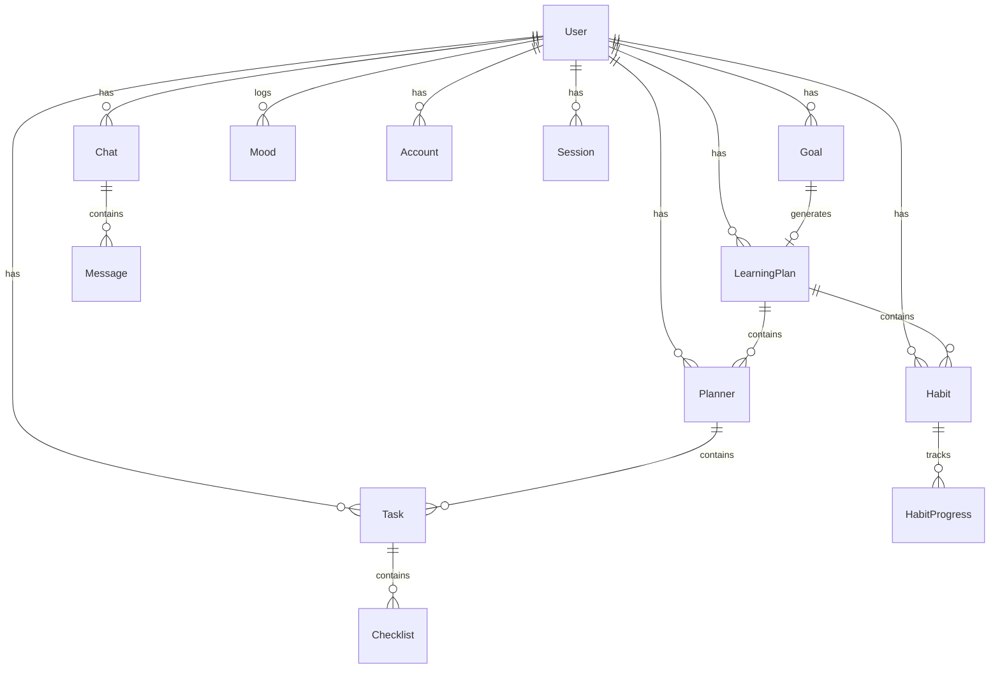
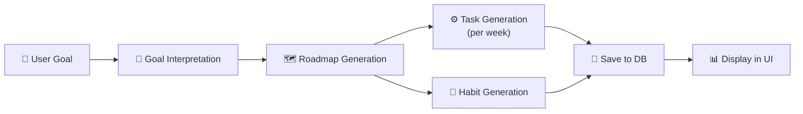
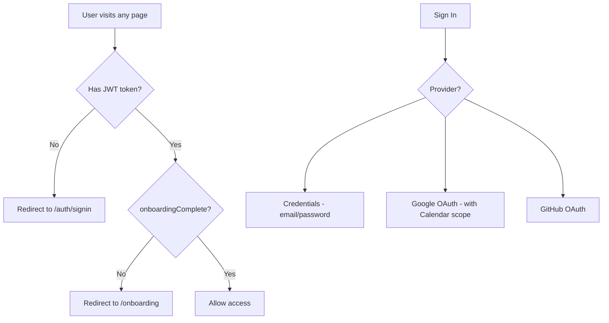

# LifePilot — Codebase Overview

> **Personal AI Learning Coach** — A full-stack Next.js 15 application that generates AI-powered learning roadmaps, tasks, habits, and insights.

---

## 🏗️ Tech Stack

| Layer | Technology |
|-------|-----------|
| **Framework** | Next.js 15 (App Router, Turbopack) |
| **Language** | TypeScript |
| **Database** | PostgreSQL via Prisma ORM |
| **Auth** | NextAuth.js v4 (Credentials, Google, GitHub) |
| **LLM** | Groq API (qwen/qwen3-32b for planning, llama-3.3-70b for chat) |
| **Styling** | TailwindCSS v4 + Radix UI primitives |
| **Charts** | Recharts |
| **Data Fetching** | SWR (client-side caching) |
| **Email** | Resend API |
| **Calendar** | Google Calendar API (googleapis) |
| **Animation** | Framer Motion |
| **Forms** | React Hook Form + Zod validation |

---

## 📁 Project Structure

```
lifepilot/
├── middleware.ts                    # Auth + onboarding guard
├── package.json                    # Dependencies & scripts
├── prisma/
│   └── schema.prisma               # Database schema (13 models)
├── src/
│   ├── app/
│   │   ├── (app)/                  # Authenticated app pages
│   │   │   ├── chat/page.tsx       # AI Chat interface
│   │   │   ├── dashboard/page.tsx  # Main dashboard
│   │   │   ├── habits/             # Habit tracking page
│   │   │   ├── insights/page.tsx   # Analytics & charts
│   │   │   ├── planner/page.tsx    # Plan detail view (tasks + habits)
│   │   │   ├── plans/[id]/page.tsx # Dynamic plan page
│   │   │   ├── settings/page.tsx   # Goals & plans management
│   │   │   └── tasks/page.tsx      # Standalone tasks page
│   │   ├── (auth)/                 # Auth pages (signin, signup, verify)
│   │   ├── api/                    # 12 API route groups
│   │   │   ├── auth/               # NextAuth handlers
│   │   │   ├── chat/route.ts       # LLM streaming endpoint
│   │   │   ├── chats/              # Chat CRUD + messages
│   │   │   ├── goals/              # Goal CRUD
│   │   │   ├── habits/             # Habit streaks
│   │   │   ├── insights/           # 6 insight endpoints + SSE
│   │   │   ├── learning-plans/     # Learning plan CRUD + habits toggle
│   │   │   ├── mood/               # Mood logging
│   │   │   ├── onboarding/         # User onboarding
│   │   │   ├── planner/route.ts    # 🧠 AI plan generation (4-step pipeline)
│   │   │   ├── tasks/              # Task CRUD + checklists + focus + today
│   │   │   └── user/               # User profile
│   │   ├── goal/page.tsx           # Initial goal creation (standalone)
│   │   ├── globals.css             # Global styles
│   │   └── layout.tsx              # Root layout
│   ├── components/
│   │   ├── chat/                   # ChatSidebar, ChatMessages, ChatPromptInput
│   │   ├── common/                 # Loaders, GoalPopover, EditGoalPopup, etc.
│   │   ├── dashboard/              # 10 dashboard widgets
│   │   ├── habits/                 # AddHabitForm, HabitList, HabitProgressChart
│   │   ├── layout/                 # Sidebar, Header, MainLayout
│   │   ├── tasks/                  # TaskList, TaskForm
│   │   └── ui/                     # 16 Radix-based UI primitives
│   ├── context/
│   │   ├── ChatContext.tsx          # Chat state management
│   │   ├── HabitContext.tsx         # Habit state management
│   │   └── TaskContext.tsx          # Task + checklist state management
│   ├── lib/
│   │   ├── auth.ts                 # NextAuth config (3 providers)
│   │   ├── constants/constants.ts  # Study hours/weeks options
│   │   ├── email.ts                # Resend email templates
│   │   ├── googleCalendar.ts       # Google Calendar create/delete
│   │   ├── groqFetch.ts            # Groq API retry wrapper
│   │   ├── password.ts             # bcrypt hash/verify
│   │   ├── prisma.ts               # Prisma client singleton
│   │   ├── prompts.ts              # 4-layer LLM prompt suite
│   │   └── utils.ts                # cn(), streak calc, habit completion
│   ├── types/
│   │   ├── chat.ts                 # Chat type
│   │   └── next-auth.d.ts          # NextAuth type augmentation
│   └── generated/prisma/           # Prisma generated client
└── public/                         # Static assets (logos, icons)
```

---

## 🗄️ Database Schema (Prisma)



### Key Models

| Model | Purpose | Key Fields |
|-------|---------|------------|
| **User** | Authentication & profile | `onboardingComplete`, `skillLevel`, `weeklyHours` |
| **Goal** | User learning objectives | `title`, `hoursPerDay`, `targetWeeks`, `preferredTime` |
| **LearningPlan** | AI-generated plan container | `planner` (JSON), `task_list` (JSON), `habits_list` (JSON) |
| **Planner** | Weekly milestone (relational) | `week`, `title`, `description`, `progress` |
| **Task** | Daily task with checklists | `title`, `status`, `dueDate`, `googleCalendarEventId` |
| **Checklist** | Sub-task item | `title`, `status`, `expectedTime` |
| **Habit** | Daily/weekly habit | `name`, `frequency`, `streak`, `progress` |
| **HabitProgress** | Completion tracking | `date`, `completed` |
| **Chat / Message** | AI conversation | `title`, `role`, `content` |
| **Mood** | Mood logging | `mood` (Happy/Sad/Neutral/Stressed/Sleepy) |

> [!NOTE]
> LearningPlan stores data in **two forms**: raw JSON blobs (`planner`, `task_list`, `habits_list`) AND relational tables (`Planner`, `Task`, `Habit`). A fallback in the frontend handles cases where relational records are missing.

---

## 🧠 AI Plan Generation Pipeline

The core intelligence lives in [route.ts](file:///Users/mithun/Downloads/lifepilot/src/app/api/planner/route.ts) and [prompts.ts](file:///Users/mithun/Downloads/lifepilot/src/lib/prompts.ts):



| Step | Prompt | LLM Model | Output |
|------|--------|-----------|--------|
| 1. Goal Interpretation | `goalInterpretationPrompt()` | qwen/qwen3-32b | `{ skills, tools, use_cases, constraints }` |
| 2. Roadmap | `roadmapPrompt()` | qwen/qwen3-32b | `{ planner: [{ week, milestone, summary, startDate, endDate }] }` |
| 3. Tasks (per week) | `taskGenerationPrompt()` | qwen/qwen3-32b | `{ week, tasks: [{ day, title, checklists }] }` |
| 4. Habits | `habitsPrompt()` | qwen/qwen3-32b | `{ habits: [{ title, frequency, description, impact }] }` |

---

## 🔌 API Routes

### Core APIs

| Route | Methods | Purpose |
|-------|---------|---------|
| `/api/planner` | POST | 4-step AI plan generation pipeline |
| `/api/learning-plans` | GET, POST | List/create learning plans |
| `/api/learning-plans/[id]` | GET, PUT, DELETE | Plan CRUD + nested planners/tasks/habits |
| `/api/learning-plans/[id]/habits/[id]/toggle` | PATCH | Toggle habit completion |
| `/api/goals` | GET, POST | Goal CRUD |
| `/api/goals/[id]` | GET, PUT, DELETE | Individual goal operations |
| `/api/tasks` | GET, POST | Task listing & creation |
| `/api/tasks/[id]` | GET, PUT, DELETE | Task CRUD |
| `/api/tasks/[id]/checklists` | GET, POST | Checklist operations |
| `/api/tasks/[id]/checklists/[id]` | PUT, DELETE | Checklist item operations |
| `/api/tasks/today` | GET | Today's tasks for dashboard |
| `/api/tasks/focus` | GET | Focus percentage calculation |

### Chat APIs

| Route | Methods | Purpose |
|-------|---------|---------|
| `/api/chat` | POST | **Edge runtime** — LLM streaming chat (Groq llama-3.3-70b) |
| `/api/chats` | GET, POST | Chat session management |
| `/api/chats/[id]` | GET, PUT, DELETE | Individual chat operations |
| `/api/chats/[id]/messages` | GET, POST | Message CRUD |

### Insights APIs

| Route | Methods | Purpose |
|-------|---------|---------|
| `/api/insights/learning-hours` | GET | Learning hours per plan |
| `/api/insights/habit-completion` | GET | Habit completion % |
| `/api/insights/goals-progress` | GET | Goal progress % |
| `/api/insights/task-stats` | GET | Completed vs pending tasks |
| `/api/insights/mood-trends` | GET | Mood trends over time |
| `/api/insights/sse` | GET | **Server-Sent Events** for live updates |

### Other APIs

| Route | Methods | Purpose |
|-------|---------|---------|
| `/api/mood` | GET, POST | Mood logging |
| `/api/habits/streaks` | GET | Habit streak data |
| `/api/onboarding` | POST | User onboarding profile setup |
| `/api/user/profile` | GET | User profile (used by middleware) |
| `/api/auth/[...nextauth]` | ALL | NextAuth handlers |

---

## 📄 Frontend Pages

| Page | Path | Type | Description |
|------|------|------|-------------|
| Dashboard | `/dashboard` | Server Component | Welcome + widgets (mood, streaks, focus, timeline) |
| Chat | `/chat` | Client Component | AI chat with sidebar, streaming, message persistence |
| Insights | `/insights` | Client Component | 5 charts (Recharts) + SSE live updates |
| Planner | `/plans/[id]` | Hybrid | Plan detail view with weekly tasks, day tabs, habits |
| Settings | `/settings` | Client Component | Goal/plan management, delete, regenerate |
| Goal Setup | `/goal` | Client Component | 3-step goal creation wizard |
| Auth | `/auth/signin`, `/auth/signup` | Client Component | Credentials + OAuth login |
| Onboarding | `/onboarding` | Client Component | Skill level, pace, format preferences |

---

## 🧩 Component Inventory

### Dashboard Widgets (10)

| Component | Status | Data Source |
|-----------|--------|-------------|
| `SmartSuggestion` | ⚡ **Static** — hardcoded suggestions | Rotates from static array |
| `TodayTimeline` | ✅ **Working** | `/api/tasks/today` |
| `MoodInsight` | ✅ **Working** | `/api/mood` |
| `StreakAchievements` | ✅ **Working** | `/api/habits/streaks` |
| `FocusPanel` | ✅ **Working** | `/api/tasks/focus` |
| `HabitStats` | ⏸️ **Commented out** | N/A |
| `LifeScoreCard` | ⏸️ **Commented out** | N/A |
| `JournalPreview` | ⏸️ **Commented out** | N/A |
| `UpcomingReminders` | ⏸️ **Commented out** | N/A |
| `PromptBox` | 🔧 **Unused** | N/A |

### Task System

| Component | Props | Notes |
|-----------|-------|-------|
| `TaskList` | `existingTasks`, `refreshPlan` | Renders task + checklist tree |
| `TaskForm` | (via context) | Add/edit checklist items via dialog |
| `TaskProvider` | children | Context for task state & API operations |

### Chat System

| Component | Notes |
|-----------|-------|
| `ChatSidebar` | Lists chat sessions, new chat button |
| `ChatMessages` | Renders messages, strips `<think>` tags |
| `ChatPromptInput` | Sends message, creates chat if needed, streams response |
| `ChatHeader` | **Commented out** — not in use |

---

## 🔐 Authentication Flow



**Providers**: Credentials (bcrypt), Google (with Calendar API scope), GitHub

**Token refresh**: Auto-refreshes expired Google OAuth tokens via `oauth2.googleapis.com`

---

## 📦 NPM Scripts

| Script | Command | Purpose |
|--------|---------|---------|
| `dev` | `next dev --turbopack` | Development server with Turbopack |
| `build` | `next build --no-lint` | Production build (linting skipped) |
| `start` | `next start` | Production server |
| `lint` | `next lint` | ESLint |
| `postinstall` | `prisma generate` | Auto-generate Prisma client |

---

## 🔗 Integrations

### Groq LLM API
- **Planning**: `qwen/qwen3-32b` at temperature 0 — 4 sequential calls per plan generation
- **Chat**: `llama-3.3-70b-versatile` at temperature 0.4 — streaming via Edge Runtime
- **Retry**: Exponential backoff (2s → 4s → 8s) on 429 rate limits
- **JSON extraction**: Regex-based `extractJSON()` strips markdown fences from LLM output

### Google Calendar
- Creates events for each generated task (if OAuth tokens available)
- Deletes events when learning plan is deleted
- Uses `googleapis` SDK with OAuth2 client

### Resend Email
- Verification email (24hr expiry) with branded HTML template
- Welcome email after verification
- Uses `RESEND_API_KEY` env var

### Server-Sent Events (SSE)
- `/api/insights/sse` polls database every 5 seconds
- Pushes live task/habit updates to the Insights page
- Auto-cleanup on client disconnect

---

## ⚙️ Key Data Flow

### Plan Generation → Display

```
Goal Page → POST /api/goals → POST /api/planner
  → 4x Groq API calls → POST /api/learning-plans
    → Prisma creates: LearningPlan (JSON) + Planner + Task + Checklist + Habit
      → Redirect to /dashboard

Plan Page → GET /api/learning-plans/[id]
  → Returns: planners[] (relational) + planner (JSON fallback)
    → PlannerPage.tsx useMemo transforms data
      → If planners[] empty → falls back to planner JSON + task_list JSON
        → Renders weekly view with day tabs
```

### Chat Flow

```
ChatPage → SWR fetches /api/chats
  → User types message → POST /api/chats (create if needed)
    → POST /api/chat (Edge, streaming)
      → Groq llama-3.3-70b streams tokens
        → ReadableStream → onAssistantStream → optimistic UI update
          → POST /api/chats/[id]/messages (save both user + assistant)
```
